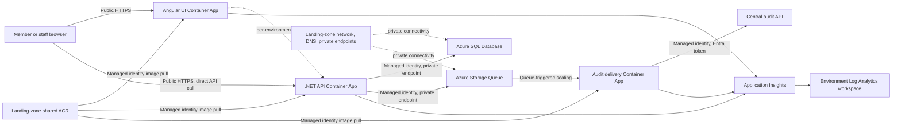

# Azure Hosting and Data Infrastructure

**Status: Proposed.** This is an infrastructure design for review, not an
approved deployment plan. It describes application-owned Azure resources and
their dependencies on an established landing zone. It does not create Bicep,
provision Azure resources, or authorize deployment.

**Planning status (2026-11-16):** The user acting as product owner and tech lead
approved both feature specifications for planning only. See the proposed
[002 demo plan](../../specs/002-member-profile-demo/plan.md) and
[003 initial-project plan](../../specs/003-initial-app-projects/plan.md).
Design and applicable security/privacy reviews remain pending; planning approval
does not approve this infrastructure direction, implementation, or deployment.

**Demo scope clarification:** The [demo research](../../specs/002-member-profile-demo/research.md)
proposes internal audit in the same SQL transaction as the business change.
The queue, central audit service, and delivery worker described below remain a
separately reviewed direction, not required or approved demo scope. The demo
plan proposes server-only Entra-authenticated telemetry with local authentication
disabled because the Application Insights JavaScript SDK does not support
Entra-authenticated ingestion. Any browser telemetry arrow below is not an
approved ingestion path; no direct browser telemetry workaround is permitted.

## Purpose and scope

This document focuses on hosting the member-profile application and its
database, including the temporary audit-event buffer. The organization is
assumed to provide an Azure landing zone. Landing-zone services are treated as
external dependencies and are not recreated by the application.

The initial deployment uses synthetic data in development, test, and production
resource groups. The production environment in this phase is a demo environment,
not approval to store real member data. The eventual production design has a
roughly two-hour recovery time objective (RTO) and recovery point objective
(RPO); the synthetic-data demo may take longer to recover and may be reset to
a known seed dataset.

## Confirmed infrastructure requirements and choices

| Area                     | Current direction                                                                                                                                                                                                                |
| ------------------------ | -------------------------------------------------------------------------------------------------------------------------------------------------------------------------------------------------------------------------------- |
| Azure organization       | Use an existing subscription and established landing zone.                                                                                                                                                                       |
| Environments             | Development, test, and production each have a separate resource group and a separate Azure Container Apps Environment.                                                                                                           |
| Region                   | South Central US is the initial region. The paired North Central US region is acceptable for eventual recovery, subject to service and landing-zone approval.                                                                    |
| Application hosting      | Host the Angular web UI and .NET 11 API as separate Azure Container Apps. Use the Container Apps-generated hostnames initially.                                                                                                  |
| API access               | The browser calls the API directly over public HTTPS ingress. The API authenticates and authorizes requests; CORS is not an authorization control.                                                                               |
| WAF                      | A managed WAF is a future direction, not available in the initial setup. Use synthetic data during this phase. Real-data readiness requires a separate security decision.                                                        |
| Container registry       | Use the landing zone's shared Azure Container Registry (ACR); do not create another registry in the application resource groups.                                                                                                 |
| SQL                      | Application Bicep creates an Azure SQL logical server and single database per environment. The demo uses serverless compute with auto-pause to reduce idle cost.                                                                 |
| Audit buffer             | Include an application-owned Azure Storage Queue for temporarily holding audit events. Retain each message until the central audit API confirms receipt; alert operations when delivery exceeds three hours.                     |
| Observability            | Each application environment has its own Log Analytics workspace and Application Insights resource. Audit records are separate and sent to the organization's central audit service.                                             |
| Landing-zone network     | The landing zone provides the Container Apps network integration, subnets, DNS, and connectivity required for private data access. Its team creates and manages the SQL and queue private endpoints and DNS integration.         |
| Identity                 | Use managed identities for workload-to-Azure-service access and for the central audit API. Assign only the required data roles at resource scope.                                                                                |
| Infrastructure ownership | Application Bicep creates application-owned resources in the environment resource groups. The landing-zone team owns the shared network and private endpoint integration. All deployment remains through approved IaC pipelines. |

These are working design choices from the architecture discussion. They are
not evidence of an approved production configuration or confirmed landing-zone
capability.

## Proposed per-environment topology

The diagram shows one environment. Repeat it independently for development,
test, and production, each with synthetic data during the initial phase.

The audit delivery worker is a proposed component to consume queued events
independently from user-facing requests. Its event-triggered scaling, recovery,
and poison-message handling require validation. Container Apps supports custom
scaling rules for Azure Queue Storage and managed identity authentication for
Azure resource scale rules; see [Container Apps scaling](https://learn.microsoft.com/en-us/azure/container-apps/scale-app).

## Application hosting and ingress

The UI, API, and proposed audit worker are separate Container Apps in the
environment's Container Apps Environment. The UI and API have public HTTPS
ingress using the generated Container Apps hostnames. The browser calls the
API directly, so each environment must configure its allowed browser origin
for CORS. CORS only controls browser cross-origin behavior; every API request
still requires server-side authentication and resource-level authorization.
Use TLS 1.2 or higher for application connections.

The API and UI can scale to zero to prioritize low idle cost. The queue
consumer can scale from queue activity and return to zero when there is no
backlog. This trades lower idle consumption for startup delay and requires
testing cold-start behavior against the target production p95 API latency of
under 300 ms at an agreed peak load. Expected peak load remains unknown.

There is no managed WAF in the initial design. Publicly reachable applications
must use the approved identity and API authorization controls, secure
configuration, and platform protections. Only synthetic data is in scope for
the initial deployment. The managed WAF, custom domain, public DNS, and
associated identity redirect URI changes are future work and need review before
real-data use.

Container images come from the shared landing-zone ACR. Each app uses managed
identity for image pull instead of registry credentials. The landing-zone
registry owner and application team must agree on repository naming, image
promotion, retention, and least-privilege pull permissions for each environment.

## SQL hosting and private access

Application Bicep creates one Azure SQL logical server and one Azure SQL
Database per environment. The synthetic-data phase uses a single database in
the serverless compute tier with auto-pause. This choice favors low idle cost
and accepts resume delay. The API connects using managed identity; SQL public
network access remains disabled, and the landing-zone team provisions the
private endpoint and DNS integration.

The serverless auto-pause choice conflicts with continuous regional
geo-replication: Microsoft documents that active geo-replication and failover
groups prevent auto-pause. Therefore, the demo configuration alone does not
meet the eventual production two-hour RTO/RPO. Before using real member data,
revisit the SQL tier, backup redundancy, recovery topology, and cost, then
validate recovery end to end. Geo-restore may take minutes or hours depending
on the workload and is not by itself a two-hour guarantee.

For the demo, recovery may rebuild infrastructure and reseed the known
synthetic dataset; preserving demo mutations is not required. The seed source,
reset procedure, backup redundancy, and permitted demo data loss still need
implementation review. Production must retain its separate two-hour RTO/RPO
goal, including application hosting, network, registry, identity, and
operational recovery dependencies.

## Audit-event delivery infrastructure

The application sends audit events to the central audit service through an
authenticated API using the workload's managed identity and Microsoft Entra
tokens. Each event records who changed what, when, and the outcome, without
before-and-after profile values. The central API deduplicates events using a
unique event ID.

When the central service is unavailable, the application must durably retain an
event before applying a profile change. If the temporary store cannot safely
retain it, the change is blocked. A queue consumer retries delivery and removes
the queued message only after the central API confirms receipt. Events remain
queued until acknowledgment; an event older than three hours triggers an
operations alert.

The selected low-idle-cost buffer is Azure Storage Queue, separate from both
the profile database and telemetry workspace. The queue and its storage account
must use managed identity, have public network access and shared-key
authorization disabled, and use private access; the landing-zone team owns the
private endpoint and DNS integration. Configure message time-to-live explicitly
so messages do not expire before central acknowledgment. Azure Queue Storage
supports a non-expiring message TTL when set explicitly; the default is seven
days. See [Queue Storage introduction](https://learn.microsoft.com/en-us/azure/storage/queues/storage-queues-introduction)
and [Storage private endpoints](https://learn.microsoft.com/en-us/azure/storage/common/storage-private-endpoints).

Storage Queue has fewer built-in broker features than Service Bus, so retry
limits, poison-message retention, replay, and alert behavior need an explicit
design. The queue and SQL are separate stores; the API's audit-intent,
profile-update, and outcome protocol must address failures between those
operations. Do not claim exactly-once processing: rely on durable retries,
event IDs, central deduplication, and reconciliation. The queue account's
regional redundancy and recovery behavior are also open.

The central audit API has not yet supplied its authorization scope, availability
contract, request schema, or response/acknowledgment contract. Confirm these
interfaces before implementing the dispatcher.

## Observability and environment isolation

Each environment has an independent Log Analytics workspace and
Application Insights resource. Configure telemetry ingestion with Entra
authentication and local authentication disabled, as required by the
constitution. Use structured logs, traces, metrics, and correlation IDs; do
not log profile data, access tokens, secrets, or audit payloads containing
personal data.

Audit records stay outside application telemetry and use the central audit
service. Application health and queue-delivery signals should support an alert
when the oldest pending audit event exceeds three hours. Define queue depth,
retry, poison-message, and central-service failure alerts during monitoring
design. Workspace retention and diagnostic access policies are open.

## Landing-zone integration contract

The application design depends on the landing-zone team to provide:

- An approved subscription and network integration for each environment.
- Container Apps-compatible networking and egress to the shared ACR, Entra
  identity endpoints, Azure Monitor, and the central audit API.
- SQL and Storage Queue private endpoints, private DNS records and links, and
  routing that permits only the required application access.
- The shared ACR, its approved image repositories, and a least-privilege
  managed-identity image-pull model, including its network access path.
- The central audit API endpoint, Entra audience/application permissions, and
  operational contact for availability and delivery incidents.
- The future managed WAF path, custom domain, and DNS ownership when they are
  introduced.

This is a dependency checklist, not evidence that these services or permissions
are already configured. Confirm subnet capacity, network policy, DNS behavior,
ACR endpoint access, regional availability, and approval workflows with the
landing-zone team before generating deployment templates.

## Well-Architected review

| Pillar                 | Current direction                                                                                                                                  | Trade-off and remaining validation                                                                                                                                                                                                                                   |
| ---------------------- | -------------------------------------------------------------------------------------------------------------------------------------------------- | -------------------------------------------------------------------------------------------------------------------------------------------------------------------------------------------------------------------------------------------------------------------- |
| Security               | Entra identities, managed identities, resource-scoped RBAC, direct API authorization, private SQL and queue endpoints, and separate audit service. | The API is publicly reachable without the future WAF. Keep the environment synthetic-data-only until security approves real-data readiness. Confirm CORS origins, external identity configuration, ACR permissions, queue permissions, and audit event minimization. |
| Reliability            | Keep environments separate, retain audit events until acknowledgment, alert after three hours, and define production recovery targets.             | Queue and SQL failure handling, duplicate delivery, poison messages, queue redundancy, and regional application recovery need testing. Demo reset does not prove production RTO/RPO.                                                                                 |
| Performance efficiency | Scale UI/API and audit worker to zero; use SQL serverless auto-pause.                                                                              | First request and database resume can be delayed. Measure p95 under a defined peak load before production.                                                                                                                                                           |
| Cost optimization      | Serverless database, scale-to-zero containers, shared registry, and asynchronous queue delivery.                                                   | Geo-redundant production recovery and telemetry volume add cost. No estimate is possible before usage, retention, and recovery choices are defined.                                                                                                                  |
| Operational excellence | Bicep-managed app resources, per-environment telemetry workspaces, centralized audit delivery, and operational alerts.                             | The landing-zone handoff, deployment identity, support owner, reset procedure, audit replay, and tested recovery runbooks remain open.                                                                                                                               |

## Open decisions and gates

- Decide database backup redundancy and the production SQL recovery design.
  The two-hour RTO/RPO must be validated before real-data readiness; serverless
  auto-pause and SQL failover groups cannot be assumed to coexist.
- Define the event state protocol that preserves the required actor, action,
  timestamp, and outcome across SQL and queue failures.
- Define poison-message retention, replay ownership, queue capacity alerts, and
  storage-account regional redundancy.
- Confirm resource naming, region availability, subnet capacity, network
  policies, and private DNS ownership with the landing-zone team.
- Confirm whether the shared ACR and central audit service can meet the
  production region-recovery objectives.
- Decide the WAF and real-data readiness gate, custom-domain timing, workspace
  and queue retention, alert recipients, and operations owner.
- Establish traffic/load estimates and a cost budget before selecting replica,
  database, backup, or telemetry retention settings.

## References

- [Member profile architecture overview](member-profile-overview.md)
- [Member profile design review](design-review.md)
- [Azure Container Apps overview](https://learn.microsoft.com/en-us/azure/container-apps/overview)
- [Azure Container Apps ingress](https://learn.microsoft.com/en-us/azure/container-apps/ingress-overview)
- [Azure Container Apps networking](https://learn.microsoft.com/en-us/azure/container-apps/networking)
- [Azure Container Apps scale rules](https://learn.microsoft.com/en-us/azure/container-apps/scale-app)
- [Container Apps image pull with managed identity](https://learn.microsoft.com/en-us/azure/container-apps/managed-identity-image-pull)
- [Azure SQL serverless compute](https://learn.microsoft.com/en-us/azure/azure-sql/database/serverless-tier-overview)
- [SQL serverless auto-pause interoperability](https://learn.microsoft.com/en-us/azure/azure-sql/database/serverless-tier-auto-pause-resume)
- [Azure SQL business continuity](https://learn.microsoft.com/en-us/azure/azure-sql/database/business-continuity-high-availability-disaster-recover-hadr-overview)
- [Azure Storage Queue introduction](https://learn.microsoft.com/en-us/azure/storage/queues/storage-queues-introduction)
- [Azure Storage private endpoints](https://learn.microsoft.com/en-us/azure/storage/common/storage-private-endpoints)
