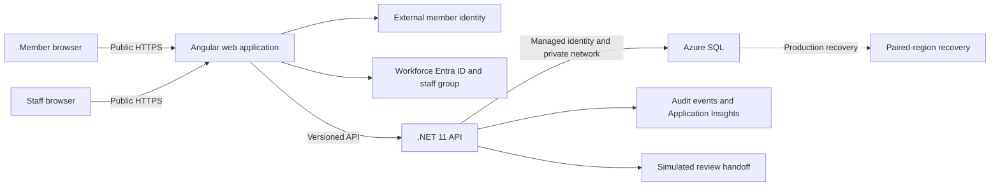

# Member Profile Application Architecture

**Status: Proposed.** This document records the current architecture baseline
for review. It does not describe an implemented or approved system. Update it as
requirements are clarified and decisions are reviewed.

**Planning status (2026-11-16):** The user acting as product owner and tech lead
approved both feature specifications for planning only. See the proposed
[002 demo plan](../../specs/002-member-profile-demo/plan.md) and
[003 initial-project plan](../../specs/003-initial-app-projects/plan.md).
This does not approve architecture, security, implementation, or deployment;
applicable human design, security, and privacy reviews remain pending.

**Demo scope clarification:** The [demo research](../../specs/002-member-profile-demo/research.md)
proposes committing business changes and required internal audit records in the
same SQL transaction. Queue/central-audit delivery and its worker below remain
a separately reviewed direction, not required or approved demo scope. The plan
proposes server-only telemetry with Entra-authenticated ingestion and local
authentication disabled: the Application Insights JavaScript SDK does not
support Entra-authenticated ingestion. Browser telemetry arrows in this proposal
do not authorize direct browser ingestion or a workaround.

## Purpose and audience

This explanation is for product, architecture, security, and engineering
reviewers. It describes the member profile application's confirmed needs, a
first-cut system boundary, and the decisions that remain open. It is not a
deployment plan, API contract, or Spec Kit implementation plan.

## Scope and design status

The [initial demo specification](../../specs/002-member-profile-demo/spec.md)
covers the complete initial demo: enrollment, profiles, staff, and memberships.
The demo uses synthetic data. The target production design must support real
member information and account-to-profile authorization. The workflow
integration described here is simulated for the demo; no ticketing product or
production integration has been selected.

The project constitution establishes Angular with TypeScript, C#/.NET 11, Azure
SQL, and Bicep. It also requires Entra-based identity, managed identities for
service access, private data-service endpoints, approved US-region residency,
auditing for state changes, and p95 API latency below 300 ms at an agreed peak
load.

The current hosting proposal uses separate Azure Container Apps for the web UI
and API. See the [Azure hosting and data infrastructure design](azure-infrastructure.md)
for per-environment resources, landing-zone responsibilities, and recovery
trade-offs.

## Confirmed requirements

| Area                           | Requirement                                                                                                                                                                                                                                                               |
| ------------------------------ | ------------------------------------------------------------------------------------------------------------------------------------------------------------------------------------------------------------------------------------------------------------------------- |
| User experience                | One public web application with member and staff-specific screens.                                                                                                                                                                                                        |
| Member access                  | A member can access only their own profile. Before staff verifies the account-to-profile link, the member can see only their own submitted enrollment details and cannot edit the profile. The demo requires email one-time-code sign-in.                                 |
| Staff access                   | Staff sign in with organization-managed Microsoft Entra accounts. Membership in a designated Entra group grants staff access to create, read, and update all profiles.                                                                                                    |
| Enrollment                     | Demo enrollment collects name, contact email, phone, date of birth, and mailing address. Staff verification can link an enrollment to a staff-created profile or approve creation of a new profile.                                                                       |
| Profile data                   | Name, contact email, phone, date of birth, and mailing address. Contact email is separate from sign-in email; changing it does not change sign-in. Whether members under 18 are in scope is unknown.                                                                      |
| Memberships                    | Members can have multiple memberships, each with a generated number, type, status, and required start date. An optional end date cannot precede it. Demo types and statuses may be placeholders; production definitions remain open. Ended memberships remain as history. |
| Updates                        | Verified members directly edit only contact email, phone, and mailing address; staff handle name and date of birth. Staff manually record simulated external review approval or rejection and apply approved membership changes; members see request status and outcome.  |
| Profile identifiers and search | The application generates a member number and a separate number for each membership. Staff need to search by member number, membership number, name, and email. A number or email alone does not establish profile ownership.                                             |
| Data ownership                 | The application is the source of truth for profile and membership data.                                                                                                                                                                                                   |
| Audit                          | Internal audit records capture who changed what, when, and the outcome. They do not need before-and-after profile values.                                                                                                                                                 |
| API                            | The web application is the initial API consumer. Other systems may consume a versioned API in the future.                                                                                                                                                                 |
| Demo and production            | The initial demo uses synthetic data. Production targets South Central US with its paired US region available for recovery. Initial production recovery objectives are roughly two hours for both restoration time and data loss.                                         |

The demo specification also requires keyboard-operable workflows, labeled
fields, and clear text errors; it does not claim accessibility certification.

## Proposed system boundary

The following diagram is a discussion model, not a deployment diagram. Azure
hosting products for the web application and API remain under review.

### Identity and authorization

The initial demo requires member sign-in using an email one-time code; the
member identity provider remains unselected. Microsoft Entra External ID is a
candidate for customer identity, not an accepted selection. Its exact
passwordless flow, configuration, and data-location implications must be
verified before that choice is made. Staff use workforce Entra ID, with a
designated group controlling staff access.

The API, not the browser, must enforce authorization on every request. It must
derive a verified member's profile association from trusted identity data and
allow access only to that member's profile. A member number, membership number,
or email address is not proof of account-to-profile ownership. Staff
verification is required before linking an external account to a profile or
granting access to full profile data.

Pending members may view only their own submitted enrollment details. The
account-to-profile matching and verification experience is intentionally not
finalized; the demo simulates it, but production must have a reviewed, secure
process.

### Data and workflows

The following entities are conceptual and do not define a database schema:

- **Member:** generated member number and contact details.
- **Membership:** generated membership number, type, status, a required start
  date, and an optional end date that cannot precede it; a member may have
  multiple memberships, including ended records.
- **Enrollment:** member-submitted enrollment information and its verification
  state.
- **Membership change request:** a member-submitted request, its status, and
  any recorded outcome visible to the requesting member.
- **Audit event:** actor, operation or changed fields, timestamp, and outcome;
  exclude profile values and other unnecessary personal data.

In the proposed demo, the application records membership-change requests. Staff
manually record approval or rejection from the simulated external review and
apply only approved changes through staff screens. The requesting member can see
the request status and any recorded outcome. The eventual production ticketing
system, its integration contract, and how final review outcomes are returned
remain open.

Inactive profiles and ended membership records are retained. The retention
period is not yet defined. Legal and privacy review is needed before setting a
production retention or deletion policy, especially if minors or international
members are in scope.

### API, data access, and operations

The Angular UI and .NET 11 API are proposed as separate Azure Container Apps in
separate development, test, and production Container Apps Environments. The
browser calls the API directly through public HTTPS ingress using generated
Container Apps hostnames initially. The API is the authorization and
business-logic boundary for both the Angular application and future consumers.
Public API contracts must be versioned. The authentication and authorization
model for future non-browser consumers is open; do not assume browser tokens
or introduce API keys. The initial phase uses synthetic data and does not
include a managed WAF.

Azure SQL is the proposed system of record. Application infrastructure creates
one SQL server and database per environment. The synthetic-data phase uses
serverless compute with auto-pause to reduce idle cost. The API connects using
a managed identity over private networking. The SQL service must use a private
endpoint with public network access disabled; the landing-zone team owns the
private endpoint and DNS integration. Encrypt data in transit and at rest;
determine customer-managed key needs during data-classification and security
review.

State-changing requests must emit structured audit events with who changed
what, when, and the outcome. The application uses a separate Azure Storage
Queue as a proposed temporary buffer and sends events to the organization's
central audit API with a managed identity. Retain each message until the
central API confirms receipt; alert when delivery takes more than three hours.
If the queue cannot durably retain the event, block the profile change. The
landing-zone team owns private endpoint and DNS integration for the queue.
Application Insights telemetry must not contain profile values or other PII;
local authentication for telemetry ingestion remains disabled per the
constitution. Errors returned to clients must not expose stack traces.

## Production recovery and residency

South Central US is the preferred initial region. Microsoft documents North
Central US as its paired region, and paired-region recovery is acceptable in
principle. For the synthetic-data phase, recovery may restore a known seed
dataset, and taking longer than two hours is temporarily acceptable. The
eventual production design retains the roughly two-hour RTO and RPO target.

The demo's serverless SQL auto-pause configuration conflicts with continuous
regional geo-replication: active geo-replication and failover groups prevent
auto-pause. Therefore, this demo configuration does not demonstrate the
eventual production recovery objective. Production recovery must cover the
web application, API, database, network and ingress, registry, identity
dependencies, operational access, and recovery procedures. Validate RTO/RPO
through end-to-end exercises. Availability targets and expected peak load are
still unknown; the p95 latency objective cannot be evaluated against an
invented load.

The current constitution limits data residency to approved US regions. Future
non-US data residency is an expressed possibility, not part of the current
design approval. It requires privacy, security, and governance review; changing
the constitution's US-only constraint requires its amendment process.

## Well-Architected review snapshot

| Pillar                 | Current design direction                                                                                                                                                                | Evidence or open concern                                                                                                                                                                     |
| ---------------------- | --------------------------------------------------------------------------------------------------------------------------------------------------------------------------------------- | -------------------------------------------------------------------------------------------------------------------------------------------------------------------------------------------- |
| Security               | Entra identities, group-based staff access, API-side authorization, verified profile linking, managed identities, private SQL and queue access, and PII-minimizing audit and telemetry. | The initial UI and API are public without the future WAF; keep synthetic data only. The member identity provider, account-claim process, and real-data security gate need review.            |
| Reliability            | Keep environments isolated; retain audit events until central acknowledgment; plan eventual paired-region recovery for the full application.                                            | Demo recovery can reset the seed dataset and take longer than two hours. Serverless SQL auto-pause conflicts with continuous geo-replication, so production RTO/RPO is not yet demonstrated. |
| Performance efficiency | Run UI, API, and audit processing on Container Apps and use SQL serverless auto-pause for the synthetic-data phase.                                                                     | Scale-to-zero and database resume delay the first request. Expected peak load and profile volume are unknown, so p95 sizing and validation remain pending.                                   |
| Cost optimization      | Prefer scale-to-zero containers and SQL auto-pause across environments; use a shared registry and queue-based audit delivery.                                                           | Production recovery and telemetry retention can add cost. Budget and usage profile are unknown.                                                                                              |
| Operational excellence | Deploy application resources with Bicep; use per-environment telemetry workspaces, central audit delivery, and recovery runbooks.                                                       | Landing-zone integration, audit replay, operations ownership, and production recovery exercises remain open.                                                                                 |

## Open decisions

See the [design review](design-review.md) and [Azure infrastructure design](azure-infrastructure.md)
for options and review prompts. Major open items include member identity
configuration, secure enrollment verification, production membership types and statuses,
ticketing integration, future API consumer authorization, expected load,
availability, budget, retention, minor-member handling, international
residency, queue failure reconciliation, and production recovery.

## References

- [Project constitution](../../.specify/memory/constitution.md)
- [Repository architecture guidance](../../.github/instructions/architecture.instructions.md)
- [Microsoft Entra External ID overview](https://learn.microsoft.com/en-us/entra/external-id/external-identities-overview)
- [Azure region pairs](https://learn.microsoft.com/en-us/azure/reliability/regions-paired)
- [Azure SQL failover groups](https://learn.microsoft.com/en-us/azure/azure-sql/database/failover-group-sql-db)
- [Azure SQL business continuity guidance](https://learn.microsoft.com/en-us/azure/azure-sql/database/business-continuity-high-availability-disaster-recover-hadr-overview)
